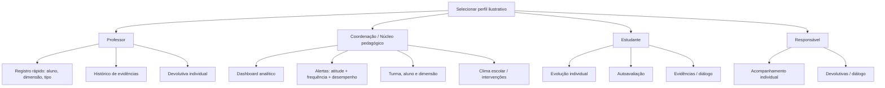

# Mapa de navegação e permissões

| Recurso | Professor | Coordenação / núcleo | Estudante | Responsável |
|---|---|---|---|---|
| Registrar observação | Turmas vinculadas | Não por padrão | Não | Não |
| Consultar histórico | Turmas vinculadas | Escopo institucional autorizado | Apenas o próprio | Apenas vinculado |
| Devolutiva | Registrar | Acompanhar | Receber | Consultar |
| Autoavaliação | Consultar | Consultar | Enviar | Não |
| Alertas / clima / intervenções | Não por padrão | Sim | Não | Não |
| Contestação / diálogo | Participar | Acompanhar | Solicitar | Solicitar |

**Nota:** permissões são o desenho pretendido, não segurança implementada. O protótipo não tem back-end.
